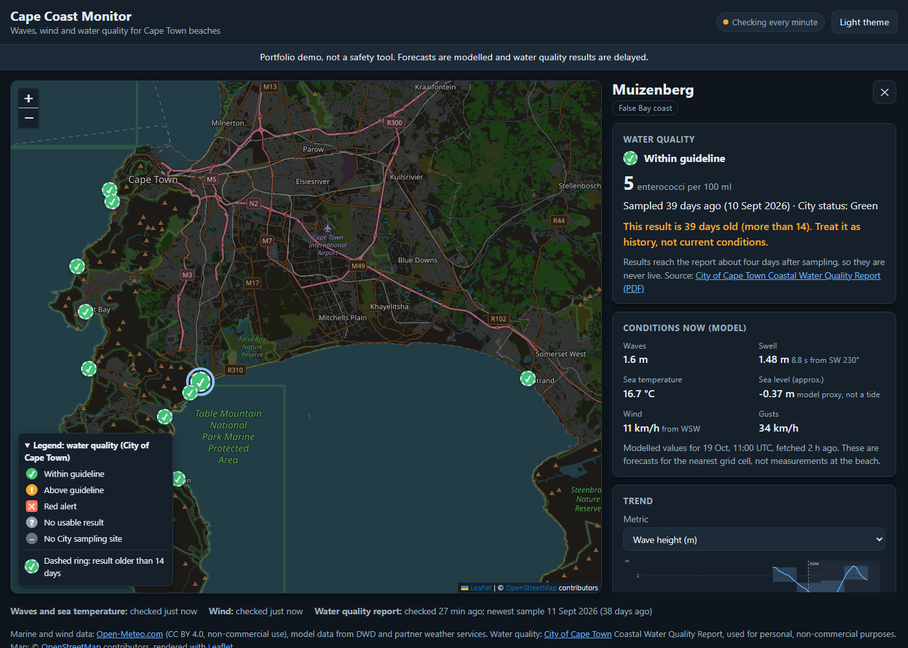
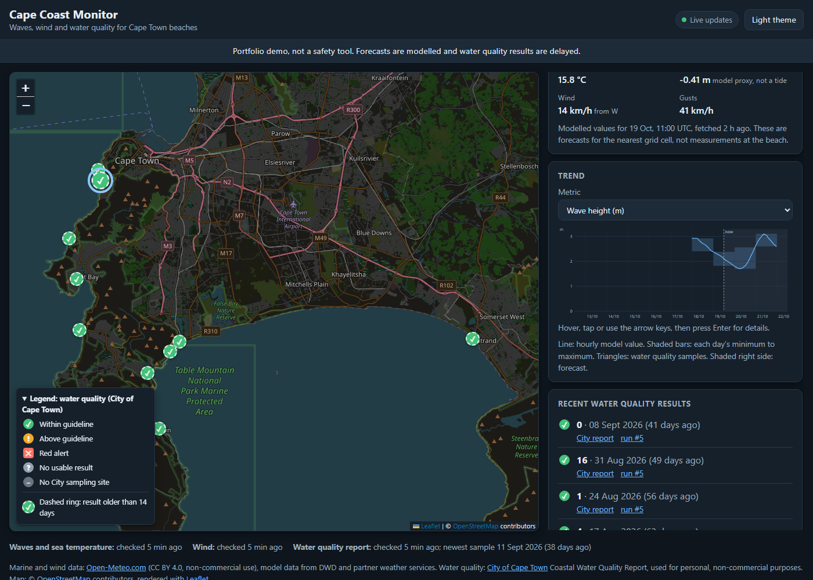
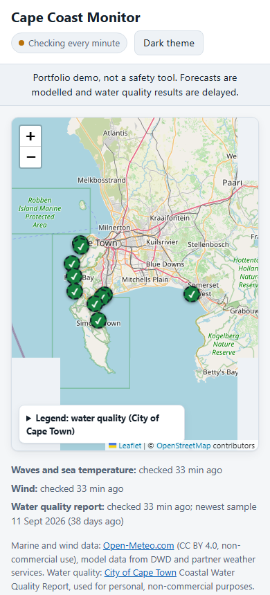
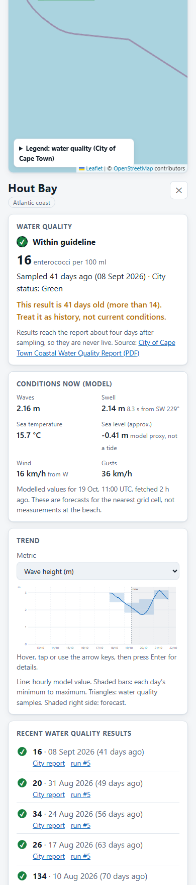
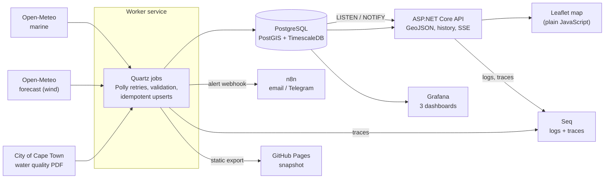
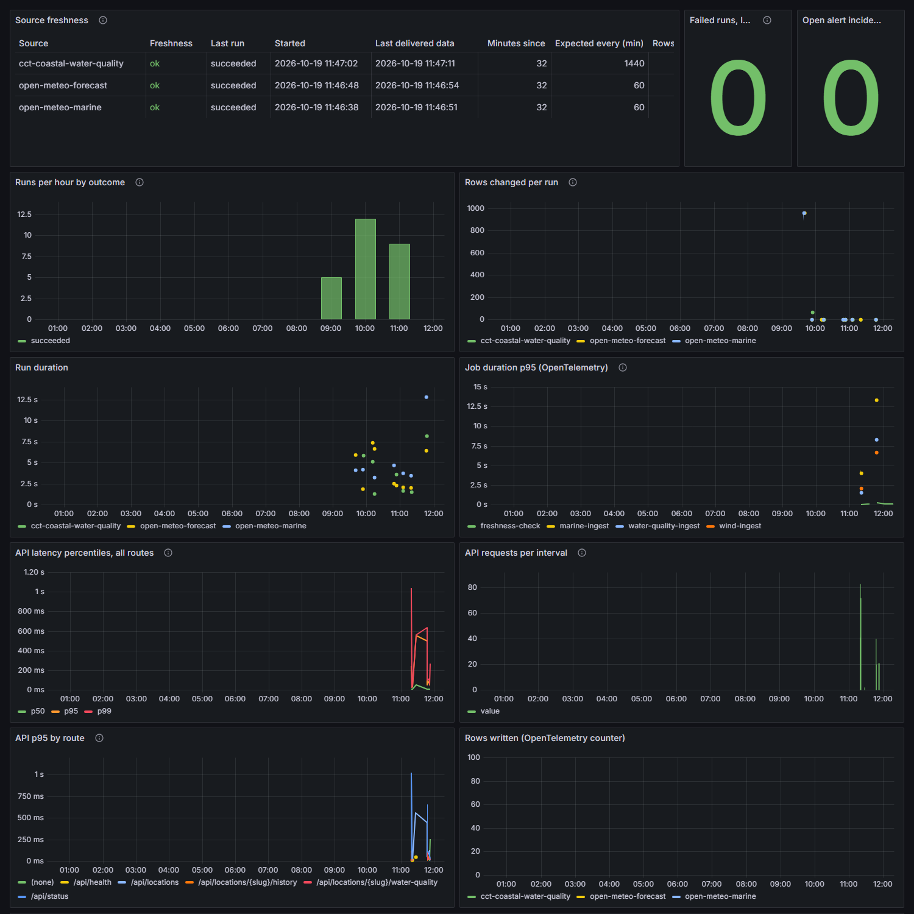
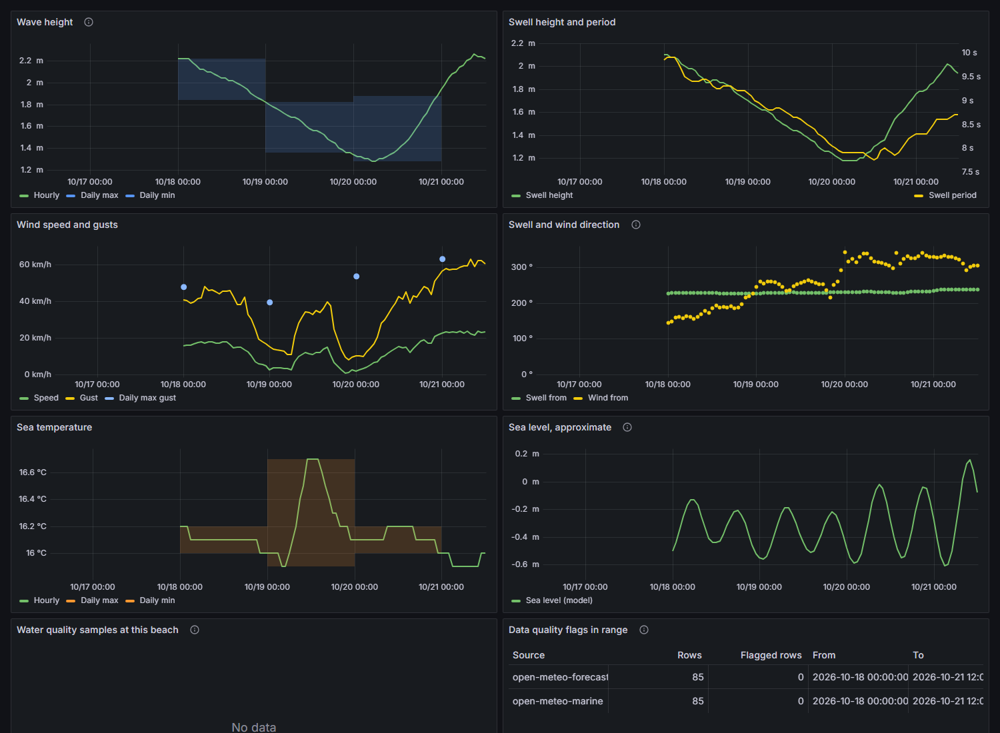
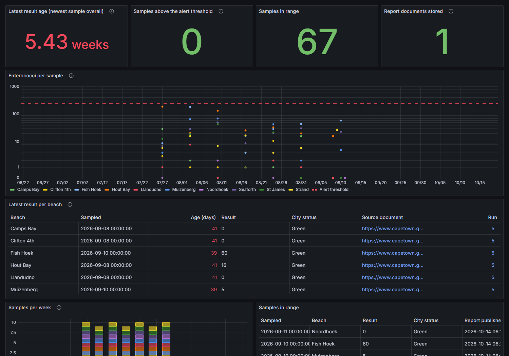

# Cape Coast Monitor

Waves, wind and coastal water quality for Cape Town beaches on one map, with history, trends and alerts.

> **Portfolio demo, not a safety tool.** Forecasts are modelled and water quality results are delayed.
> Do not use this to decide whether it is safe to swim.

| | |
|---|---|
|  |  |

<p>
  
  
</p>

It pulls ocean and wind forecasts from Open-Meteo and the City of Cape Town's coastal water quality report, stores
everything in PostgreSQL with PostGIS and TimescaleDB, and shows it on a Leaflet map. Every number on screen can be traced:
from a point on a chart to the ingestion run that wrote it, and from a water quality result to the City document it came from.

Built as a portfolio project to show spatial data, time-series storage and backend engineering working together: scheduled
ingestion with retries and an audit trail, idempotent writes, defensive PDF parsing, alerting with deduplication,
and observability of the pipeline itself.

## Architecture



| Part | What it does |
|---|---|
| `src/CapeCoast.Worker` | Quartz jobs: marine and wind hourly, the City report daily, freshness checks, optional static export. Runs alert rules after each ingestion |
| `src/CapeCoast.Api` | Minimal API serving GeoJSON, history, water quality, status and Server-Sent Events, plus the frontend and the admin endpoints |
| `src/CapeCoast.Infrastructure` | Data access (Dapper, Npgsql), source adapters, parsers, alerting, telemetry, migrations (DbUp) |
| `src/CapeCoast.Core` | Domain types, validation, alert evaluation, interfaces. No dependencies on anything else |
| `db/migrations` | SQL migrations, including hypertables, compression, retention and continuous aggregates |
| `docker/`, `docker-compose.yml` | The whole stack |
| `tests/`, `tools/` | xUnit and Testcontainers tests, node tests for the frontend, a PDF probe, a dashboard checker, snapshot scripts |

## Quick start

You need Docker (with Compose) and nothing else. Developing also needs the .NET 8 SDK and, for the frontend tests, Node 22+.

```bash
cp .env.example .env        # PowerShell: Copy-Item .env.example .env
# edit .env and replace every "change-me"
docker compose up --build
```

Within a minute the worker has fetched marine and wind data, and shortly after it has downloaded and parsed the City report.

| Service | URL | Notes |
|---|---|---|
| Map and API | http://localhost:8088 | `API_PORT` in `.env` changes it. Swagger UI at `/swagger` |
| Grafana | http://localhost:3000 | `admin` and `GRAFANA_ADMIN_PASSWORD`. Datasource and dashboards are provisioned |
| Seq | http://localhost:5341 | Logs and traces. Published on localhost only and has no login, see [docs/observability.md](docs/observability.md) |
| n8n | http://localhost:5678 | Import the alert workflow, see [docs/alerts.md](docs/alerts.md) |
| Postgres | localhost:5432 | Localhost only |

The admin endpoints (`/api/admin`) need a login: `ADMIN_USERNAME` and `ADMIN_PASSWORD` for the Admin role, and optionally
`VIEWER_USERNAME` and `VIEWER_PASSWORD` for read-only access. A role with no password set (or still set to the `change-me` placeholder) cannot sign in.

Useful one-offs:

```bash
docker compose run --rm worker --evaluate-alerts                 # run the alert rules once
./tools/publish-snapshot.sh                                      # write the static snapshot into site-data/ (see below)
GRAFANA_ADMIN_PASSWORD=... python tools/check_dashboards.py      # run every dashboard query through Grafana
```

## Data sources and attribution

| Data | Source | Terms |
|---|---|---|
| Waves, swell, sea temperature, sea level | [Open-Meteo Marine API](https://open-meteo.com/en/docs/marine-weather-api), model data from DWD and partner weather services | CC BY 4.0, free for non-commercial use, attribution required |
| Wind speed, gusts, direction | [Open-Meteo Forecast API](https://open-meteo.com/) | Same |
| Water quality (enterococci) | City of Cape Town, [Coastal Water Quality Report](https://www.capetown.gov.za/Work%20and%20business/Commercial-health-and-safety/Environmental-health/coastal-water-quality) | Copyright City of Cape Town, see the note below |
| Map | © [OpenStreetMap](https://www.openstreetmap.org/copyright) contributors, rendered with [Leaflet](https://leafletjs.com/) | ODbL, BSD-2 |

The sea level shown is `sea_level_height_msl` from the marine model. It is an **approximate proxy and not official tide data**,
and is labelled as such everywhere it appears.

> **About the City's data.** The City's [terms of use](https://www.capetown.gov.za/general/terms-of-use/) reserve all rights,
> allow personal, non-commercial use with credit, prohibit redistribution without written permission and say nothing about
> automated access. This project fetches one file a day for personal, non-commercial use, credits the City, links to the City's
> own document and does not commit its PDFs. **Serving the results from a public server is a form of redistribution**, so ask the
> City (the terms page gives cct.webmaster@capetown.gov.za) before exposing a live instance publicly. The static snapshot
> described below leaves the City's results out by default for the same reason.

### Water quality data in detail

- **Source choice:** the City publishes a Summer Dashboard (ten results per beach but one date) and the Coastal Water Quality
  Report. The report is the better source: site codes, coordinates, the latest dated result and status, and previous results by week.
  The City's ArcGIS server only exposes inland water quality, so there is no structured feed and the PDF is parsed.
- **Parsing:** the PDF is a printed dashboard whose text order is scrambled, so rows are rebuilt from word positions (PdfPig).
  A parse is only written if at least 30 site rows were found and 90% were clean. Otherwise the run is `flagged`, the document is
  still stored and nothing is written. `tools/PdfProbe` dumps word positions or runs the parser against a file.
- **Qualifiers:** `>2419` and `<10` keep their number with the qualifier in its own column. `ND` and `TFD` store no number, only the qualifier.
- **Dates:** the latest result has its real sample date. Older results are only labelled with the Monday of their sampling week and
  are stored under that date. The week column covering the latest sample is the same sample, so it is not stored twice.
- **Delay:** results reach the report days after sampling, and the report itself can lag further. Nothing here is live, and the UI
  says how old each result is.
- **Which sites:** ten City sites stand in for the ten beaches (`db/migrations/0005_city_site_codes.sql`). That mapping is a judgment call.
- **Guideline:** the City states that a single result below 240 cfu/100 ml is acceptable for recreational use. The figure is a normal
  alert rule and a display setting, not a constant in the code. See [docs/alerts.md](docs/alerts.md) for the 200 versus 240 question.

## Design decisions

**Idempotent writes.** Every observation is keyed on location, source and hour, and written with
`INSERT ... ON CONFLICT DO UPDATE ... WHERE (old values) IS DISTINCT FROM (new values)`. Running a job twice writes nothing the
second time, and the number of rows a run reports as changed is the number that really changed. Water quality is keyed on beach and
sample date, and a report is skipped entirely when its SHA-256 matches one already stored. A test runs each job twice against a
real Timescale container and checks there are no duplicates.

**Gaps are gaps.** A missing or out-of-range value is stored as NULL with an entry in `quality_flags` and the run is marked
`flagged`; nothing is interpolated. Charts break the line at a missing hour, an alert rule that needs three hours of data says
nothing when the data has a hole, and a source that has delivered nothing for three intervals is reported stale. A water quality
series with weeks missing shows the weeks missing.

**Retention.** Raw hourly marine and wind rows are kept 90 days and compressed after 7. Daily min, max and average continuous
aggregates are kept indefinitely (and use real-time aggregation so today is included). Water quality samples are kept forever, they
are few and valuable. App metrics are kept 30 days.

**Inconclusive is not "fine".** Alert evaluation distinguishes "checked and within limits" from "could not tell" (no fresh data, a
gap, not enough baseline). Only the first resolves an incident, so a feed outage never silently closes alerts.

**Why no message queue.** Each run fetches a few thousand hourly values and writes only the few hundred that changed. One worker
process, Quartz for scheduling and Postgres for storage cover that, and a broker would add a service to run and monitor without
buying anything. The two places that look like they want a queue don't: pushing updates to browsers uses Postgres `LISTEN/NOTIFY`,
and alert delivery uses columns on the incident row that record what has and hasn't been sent, so a failed message is retried on the
next evaluation. The trade-off is at-least-once delivery, and a single worker instance is assumed.

**Metrics live in Postgres.** The brief lists Grafana reading Postgres and no metrics server, so a small OpenTelemetry exporter
writes metrics into a Timescale table that Grafana charts like everything else. Latency percentiles are estimates computed from the
histogram buckets per 30-second interval, and the docs say so. The meters are standard, so adding Prometheus is one exporter.

**Frontend without a framework.** Plain ES modules and one vendored library (Leaflet), an SVG chart written for this project, and
a Content-Security-Policy that allows scripts from the site itself only. The chart, formatting and status logic are pure functions
with node tests.

## API

Swagger UI is at `/swagger`. Everything under `/api` is public and read-only except `/api/admin`.

| Endpoint | What it returns |
|---|---|
| `GET /api/locations` | GeoJSON FeatureCollection, latest marine, wind and water quality per beach, each with its own timestamps |
| `GET /api/locations/{slug}/history?metric=&from=&to=&interval=` | Time series. `interval` is `raw`, `day` or `week` |
| `GET /api/locations/{slug}/water-quality?limit=` | Recent samples, each with its source document and ingestion run |
| `GET /api/runs/{id}` | One ingestion run, to trace a point back to the job that wrote it |
| `GET /api/metrics` | The metric names `history` accepts |
| `GET /api/health`, `GET /api/status` | Database check, per-source freshness and recent runs |
| `GET /api/stream` | Server-Sent Events: an `update` event when a run writes new rows |
| `POST /api/auth/login` | Sign in (cookie). Viewer reads admin data, Admin changes it |
| `/api/admin/...` | Alert rules, maintenance windows and locations |

- **Aggregates:** `day` and `week` read the daily continuous aggregates where the metric has one, and aggregate raw rows otherwise.
  Raw requests are capped at 31 days and aggregated ones at 400.
- **Current values:** "latest" is the newest row at or before now, so a forecast hour in the future is never shown as current.
- **Hardening:** all inputs are validated (metrics come from a whitelist, never from the request into SQL), public routes and login
  are rate limited, each client may hold a few streams open, sessions are HttpOnly SameSite=Strict cookies.

## Frontend

- **Map:** markers use the City's status colour plus a distinct glyph and shape, so colour is not the only signal. A dashed ring
  marks a result older than 14 days, so an old green is never mistaken for a current one.
- **Panel:** latest water quality with its age and source link, model conditions, a trend chart and the recent results.
- **Chart:** hourly line, each day's min to max as a band (so outliers show), the forecast shaded and water quality samples on the
  axis. Click a point, or use the arrow keys and Enter, to see the ingestion run that wrote it and the nearest water quality sample
  with its source document.
- **Live updates:** Server-Sent Events trigger a refetch, falling back to polling if the stream drops.
- **Also:** deep links (`#beach=muizenberg`), light and dark themes, keyboard support, phone layout with 16px gutters and no
  horizontal scroll.

## Alerting

Rules live in the database: static thresholds (with an optional duration) or a deviation from the trailing 30-day norm. They are
evaluated after every ingestion run. Each rule and beach has at most one open incident, repeat breaches only update it, clearing
sends one "resolved" message, maintenance windows suppress everything for a beach and a cooldown stops a hovering value from
messaging every hour. Messages go to an n8n webhook with a documented payload, and `n8n/capecoast-alerts.workflow.json` routes
them to email and Telegram. Details: [docs/alerts.md](docs/alerts.md).

## Observability

Structured Serilog logs to Seq with a correlation id on every line, OpenTelemetry spans for requests, jobs, ingestion runs and alert
evaluation, and metrics (job duration, rows ingested, failures per source, API p50/p95/p99) charted in three provisioned Grafana
dashboards: pipeline health, beach trends and water quality history.

| Pipeline health | Beach trends | Water quality history |
|---|---|---|
|  |  |  |

Details: [docs/observability.md](docs/observability.md).

## Static snapshot and GitHub Pages

The worker can write everything the map needs as plain JSON, and the same frontend then runs without the server, for example on
GitHub Pages. In that mode the page shows a "Snapshot" badge, has no live updates, and the chart is anchored to the time of the
snapshot.

```powershell
./tools/publish-snapshot.ps1        # or tools/publish-snapshot.sh, writes site-data/
git add site-data; git commit -m "Update snapshot"; git push
```

The `pages` workflow publishes `site-data/` with the frontend whenever either changes. Turn it on once under
*Settings, Pages, Source: GitHub Actions*. The worker can also refresh the export on a schedule: set `Export__Directory`.

**The snapshot contains no City water quality data unless you ask for it** (`-WithWaterQuality`, `--with-water-quality`,
or `Export__IncludeWaterQuality=true`), because of the City's terms above. Without it the map says so in the legend and panel.
The committed `site-data/` is such a snapshot.

## Testing and CI

```bash
dotnet test                                    # xUnit, parsers and logic plus integration tests on a real TimescaleDB (Testcontainers, needs Docker)
node --test "tests/frontend/*.test.mjs"        # frontend logic
dotnet format --verify-no-changes              # what CI checks for style
```

The integration tests cover: running each job twice for duplicates, the PDF parser against a synthetic PDF with the City's layout,
alert deduplication, cooldown and maintenance suppression, the API over real HTTP including auth, rate limiting and SSE, the metrics
exporter, and the static export. No City PDF is stored in the repository, so the parser fixture is generated in the test.
GitHub Actions builds, runs both test suites and checks formatting; a second workflow publishes Pages.

## Known limitations

- **Coarse model data.** Open-Meteo returns the nearest model grid cell (the marine grid is several kilometres wide), so per-beach
  waves and swell are regional values. They are forecasts, not measurements, and stored hours are overwritten by newer model runs,
  so history is "what the model currently says", not an archive of observations.
- **Water quality is old and sparse.** Results lag sampling, the City report is not always updated promptly (at the time of writing
  the newest samples are from mid-September), older results are only dated to their week, and only ten of the City's ~70 sites are tracked.
- **PDF parsing is layout-dependent.** It refuses and flags when the structure changes, but a change that keeps the same shape and
  alters the meaning of a column would not be caught.
- **Simple auth.** Two accounts from environment variables, no user management, no password reset. Fine for a portfolio demo.
- **One worker.** Evaluation is serialised in-process and the database prevents duplicate incidents, but running several workers
  could send a message twice. Delivery is at-least-once.
- **Percentiles are estimates** from histogram buckets, coarse below about 5 ms.
- **No browser end-to-end tests.** The UI was checked by hand in desktop and phone sizes, and its logic is unit tested.
- **Not a safety tool,** and not official tide data.

## Repository layout

```
src/        Core, Infrastructure, Worker, Api (the frontend is src/CapeCoast.Api/wwwroot)
db/         SQL migrations
docker/     Dockerfiles and the provisioned Grafana datasource and dashboards
n8n/        Exported alert workflow
tests/      xUnit tests, frontend node tests
tools/      PdfProbe, dashboard checker, snapshot scripts
docs/       alerts.md, observability.md, screenshots, probe responses
site-data/  The static snapshot published to GitHub Pages
```

Marine and wind data by [Open-Meteo.com](https://open-meteo.com/) (CC BY 4.0), water quality results by the City of Cape Town,
map data © OpenStreetMap contributors.
